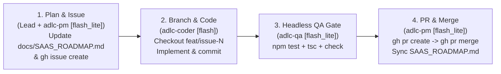

# ADLC — Agentic Development Life Cycle Skill

This skill standardizes how features, UI improvements, and bug fixes are planned, built, verified, and shipped in `oktayibis/deck-studio` while minimizing LLM token/model costs through strict **Subagent Model Tiering**.

---

## 1. Subagent Definitions & Model Tiering

Before delegating work, ensure the three ADLC subagents are defined via `define_subagent`:

### 1.1 `adlc-pm` (Always invoke with `Model: "flash_lite"`)
- **Purpose**: Manages GitHub Issues, Labels, Milestones, Pull Requests (`gh` CLI), and updates `docs/SAAS_ROADMAP.md`.
- **Why `flash_lite`**: CLI execution, JSON formatting, and markdown table updates require zero deep reasoning and run 10× faster and cheaper on `flash_lite`.

### 1.2 `adlc-coder` (Always invoke with `Model: "flash"`, `Workspace: "share"`)
- **Purpose**: Implements a single, well-scoped GitHub Issue on an isolated git branch (`feat/issue-<N>-<slug>`), writes unit/Playwright tests, and pushes the branch.
- **Why `flash`**: When the Lead Architect provides a clear file-level spec in the Issue/Prompt, `flash` writes clean TypeScript/JS/CSS code at a fraction of `pro` cost.

### 1.3 `adlc-qa` (Always invoke with `Model: "flash_lite"` or `"flash"`)
- **Purpose**: Runs `npx tsc --noEmit`, `npm test`, and `npm run check` (headless Chromium checker), captures screenshots if UI changed, and posts a verification summary on the GitHub Issue/PR via `gh issue comment` or `gh pr comment`.

---

## 2. Standard End-to-End ADLC Loop

### Step 1: Triage & Issue Creation (`adlc-pm` on `flash_lite`)
Run `.agents/skills/adlc/scripts/adlc-cli.sh status` or use `gh issue create`:
- Assign labels:
  - **Model Tier Label**: `model:flash-lite`, `model:flash`, or `model:pro`
  - **Area Label**: `area:ui`, `area:engine`, `area:saas`, `area:agent`, `area:brand-kit`
  - **Priority Label**: `priority:p0`, `priority:p1`, `priority:p2`
- Record the Issue number `#N` in `docs/SAAS_ROADMAP.md`.

### Step 2: Scoped Implementation (`adlc-coder` on `flash`)
Invoke `adlc-coder` with:
- Exact issue number `#N` and branch name `feat/issue-<N>-<slug>`
- Exact files to touch and acceptance criteria
- Instruction to run `npx tsc --noEmit` before committing.

### Step 3: Automated Verification (`adlc-qa` on `flash_lite`)
Run `.agents/skills/adlc/scripts/adlc-cli.sh verify`:
1. `npx tsc --noEmit` — Domain & TypeScript schema check
2. `npm test` — All 7 automated security, quota (`2/4/16` & `4/20/100`), extractor, checker, dock, and MCP tests
3. `npm run check` — Headless Chromium 8-point WCAG AA & geometry check on the Brand Component Gallery

### Step 4: Pull Request, Review & Roadmap Sync
1. Push branch: `git push -u origin feat/issue-<N>-<slug>`
2. Create PR: `gh pr create --title "..." --body "Closes #<N> ..."`
3. Once verified, merge PR: `gh pr merge --squash --delete-branch`
4. Update `docs/SAAS_ROADMAP.md` status to `✅ Done (PR #M)`.

---

## 3. Helper Script Commands

Use `.agents/skills/adlc/scripts/adlc-cli.sh`:
- `./.agents/skills/adlc/scripts/adlc-cli.sh init-labels` — Creates standard ADLC labels (including `model:flash-lite`, `model:flash`, `model:pro`) on GitHub.
- `./.agents/skills/adlc/scripts/adlc-cli.sh status` — Displays open GitHub Issues, open PRs, and current branch status.
- `./.agents/skills/adlc/scripts/adlc-cli.sh verify` — Runs the full pre-PR verification gate (`tsc` + `npm test` + headless Chromium check).
